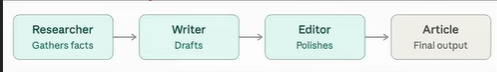
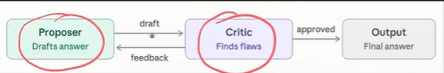
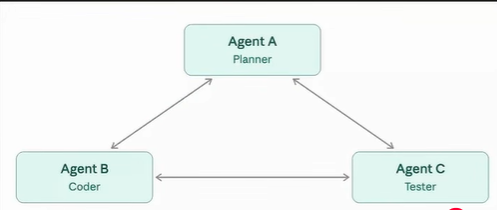

# Google ADK — Learning Notes

## Source

[Google ADK Masterclass: The LangGraph Alternative You Need to Know](https://www.youtube.com/watch?v=d2VELpoPQzY&t=28s)

---

# 1. What is an Agent?

An agent is what you get when you let a model take actions in a loop toward a goal — it decides what to do, does it, observes the result, and decides again, until the goal is met or it gives up.

### Three Properties of an Agent

**1. Tool Use**

It can act on the world (search, call APIs, read/write files, run code), not just emit words.

**2. Autonomy Over Control Flow**

It decides the sequence of steps, rather than a developer hardcoding them. The path isn't known in advance.

**3. Feedback Loops**

It observes the outcome of each action and adapts, so later steps depend on what earlier ones returned.

---

# 2. Multi-Agent System

A multi-agent system is a setup where several AI agents work together to accomplish a task.

Each agent has its own LLM, tools, memory and loop but usually with a narrower role.

Instead of one agent doing everything, the work is split up.

**Example:** A coding system might have:
- One agent that plans.
- One agent that writes code.
- One agent that tests.
- One agent that reviews.

---

# 3. Benefits of Using More Than One Agent

### 1. Focus
Each agent gets a short, specific prompt and only the tools it needs, so it performs better at its job.

### 2. Context Limits
A single agent’s context window fills up on big tasks. Subagents can each read a lot and return only a short summary.

### 3. Speed
Independent subtasks can run in parallel.

### 4. Checks and Balances
A separate reviewer agent hasn’t seen how the work was produced, so it judges the output more objectively.

---

# 4. The Trade-offs

| Trade-off | Description |
|---|---|
| **Complexity** | Multi-agent systems are complex to build and maintain in comparison to single-agent systems. |
| **Cost** | More agents means more model calls and more tokens, often several times more than one agent. |
| **Coordination Problems** | Agents can misunderstand each other, duplicate work, or lose important details when handing off. |
| **Harder to Debug** | When something goes wrong, it’s harder to trace which agent caused it. |

---

# 5. Common Patterns

## 5.1 Orchestrator–Worker (Manager and Subagents)

A lead agent breaks the task into parts, hands each part to a worker agent, then combines the results.

This is the most common pattern today, used in many research and coding agents.

---

## 5.2 Pipeline (Sequential)

Agents pass work down a line, like an assembly line. Each agent’s output becomes the next agent’s input.

---

## 5.3 Parallel

Several agents tackle different pieces, or the same piece, at the same time.

Their outputs are then merged, or put to a vote to pick the best one.

---

## 5.4 Debate or Critique

One agent proposes and another critiques.

They go back and forth until the critic is satisfied, which catches mistakes a single agent would miss.

---

## 5.5 Peer Collaboration

Agents talk to each other freely, with no single boss.

This is flexible but harder to control, so it’s less common in production.

