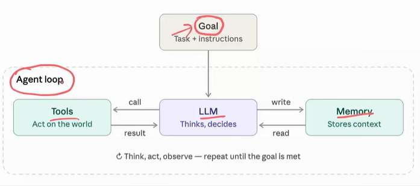
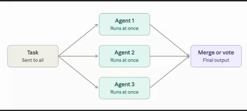
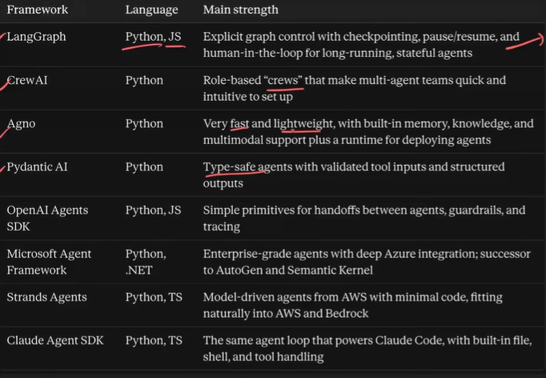

# Google ADK — Learning Notes

## Source

[Google ADK Masterclass: The LangGraph Alternative You Need to Know](https://www.youtube.com/watch?v=d2VELpoPQzY&t=28s)

---

# 1. What is an Agent?

An agent is what you get when you let a model take actions in a loop toward a goal — it decides what to do, does it, observes the result, and decides again, until the goal is met or it gives up.

### Three Properties of an Agent

**1. Tool Use**

It can act on the world (search, call APIs, read/write files, run code), not just emit words.

**2. Autonomy Over Control Flow**

It decides the sequence of steps, rather than a developer hardcoding them. The path isn't known in advance.

**3. Feedback Loops**

It observes the outcome of each action and adapts, so later steps depend on what earlier ones returned.

---

# 2. Multi-Agent System

A multi-agent system is a setup where several AI agents work together to accomplish a task.

Each agent has its own LLM, tools, memory and loop but usually with a narrower role.

Instead of one agent doing everything, the work is split up.

**Example:** A coding system might have:
- One agent that plans.
- One agent that writes code.
- One agent that tests.
- One agent that reviews.

---

# 3. Benefits of Using More Than One Agent

### 1. Focus
Each agent gets a short, specific prompt and only the tools it needs, so it performs better at its job.

### 2. Context Limits
A single agent’s context window fills up on big tasks. Subagents can each read a lot and return only a short summary.

### 3. Speed
Independent subtasks can run in parallel.

### 4. Checks and Balances
A separate reviewer agent hasn’t seen how the work was produced, so it judges the output more objectively.

---

# 4. The Trade-offs

| Trade-off | Description |
|---|---|
| **Complexity** | Multi-agent systems are complex to build and maintain in comparison to single-agent systems. |
| **Cost** | More agents means more model calls and more tokens, often several times more than one agent. |
| **Coordination Problems** | Agents can misunderstand each other, duplicate work, or lose important details when handing off. |
| **Harder to Debug** | When something goes wrong, it’s harder to trace which agent caused it. |

---

# 5. Common Patterns

## 5.1 Orchestrator–Worker (Manager and Subagents)

A lead agent breaks the task into parts, hands each part to a worker agent, then combines the results.

This is the most common pattern today, used in many research and coding agents.

---

## 5.2 Pipeline (Sequential)

Agents pass work down a line, like an assembly line. Each agent’s output becomes the next agent’s input.

---

## 5.3 Parallel

Several agents tackle different pieces, or the same piece, at the same time.

Their outputs are then merged, or put to a vote to pick the best one.

---

## 5.4 Debate or Critique

One agent proposes and another critiques.

They go back and forth until the critic is satisfied, which catches mistakes a single agent would miss.

---

## 5.5 Peer Collaboration

Agents talk to each other freely, with no single boss.

This is flexible but harder to control, so it’s less common in production.

---

# Why do we need libraries? 

---

**Control flow:** branching, retries, timeouts, step limits, and fallbacks when a tool fails or the model returns something malformed. 

**Multi-agent orchestration:** routing work between agents, passing state between them, running branches in parallel, and merging results.

**Provider lock-in with custom code** If you write custom code directly on one provider’s SDK, your code becomes tied to that provider’s specific formats: 

**Message format:** how roles, system prompts, and multi-part content (text, images, files) are structured. 

 

**Tool calling:** how tool schemas are defined, how the model returns a tool call, and how you send the result back. These differ across providers in small but breaking ways. 

 

**Streaming events:** each provider emits different event types and orders, so your streaming and UI code is provider-specific. 

 

**Provider-only features:** prompt caching, extended thinking, built-in web search, and structured output modes work differently or don’t exist elsewhere. 

 

**Errors and limits:** rate-limit handling, retries, and token counting are all written against one API. 

---

# Frameworks for building Agents

---
# What is Google ADK
The Agent Development Kit (ADK) is an open-source framework from Google for building, evaluating, and deploying AI agents and multi-agent systems. It’s a “code-first” toolkit: developers define an agent’s instructions, tools, and orchestration in ordinary source code rather than through a visual builder or a long prompt. 

## How Google ADK came into existence 
**1. Origins: an internal Google framework** 

Not built from scratch for the public 
Already used inside Google to power:  
Agentspace 
Customer Engagement Suite (CES) 
Later open-sourced so outside developers could build agents the same way 

 

**2. Public launch: Google Cloud Next 2025**
Announced on April 9, 2025 
Python only at first 
Pitch: build an AI agent in under 100 lines of Python code 
Later added support for other languages as well 

 

**3. Part of a bigger agent strategy, launched with two companions** 
**Agent2Agent (A2A) protocol ** 
Open standard, announced the same day as ADK 
More than 50 launch partners 
Lets agents from different vendors and frameworks discover each other and collaborate 
**Agent Engine ** 
Fully managed runtime in Vertex AI for deploying agents to production 
Framework-agnostic: deploys agents built with ADK, LangGraph, CrewAI, or others 

 

**4. Competitive context**

Microsoft already had AutoGen 
OpenAI and others were shipping their own agent toolkits 
ADK was Google’s answer for developers on the Gemini and Google Cloud stack 

# Key features of Google ADK 
**Built for multi-agent systems:** Compose specialized agents into teams, each with a clear role such as planning, execution, review, or routing. 

 

**Works with any model:** Optimized for Gemini, but runs models from other providers through adapters such as LiteLLM, so you aren’t locked into one vendor. 

 

**Supports multiple languages:** Official SDKs for Python, Java, Go, and TypeScript make ADK a strong option for teams outside the Python ecosystem. 

 

**Native A2A support:** Through the Agent2Agent (A2A) protocol, ADK agents can work with agents built on other frameworks or by other vendors. For example, an ADK agent can hand a task to a LangGraph or CrewAI agent without any custom integration code, because A2A gives them a shared language. 

 

**Strong Developer Experience:** The adk web interface shows each prompt, tool call, and agent handoff, so you can see exactly what an agent did and why. 

 

**Built-in evaluation:** Test agents against predefined scenarios and catch regressions whenever prompts, tools, or models change. 

 

**Structured context:** Sessions, memory, tool outputs, and artifacts are stored as structured context instead of one long chat history, which keeps agents efficient on long-running tasks 

# Trade-offs 
**Opinionated structure:** ADK enforces a set project layout and lifecycle. That’s fast when your project fits, and restrictive when it doesn’t. 

 

**Google Cloud gravity:** The framework is portable, but the smoothest deployment and operations run through Google’s ecosystem. Teams on other clouds get less of the benefit. 

# Curriculum 
1.What is Google ADK 

2.Setup + Your first agent in ADK 

3.Tools 

4.Structured Output 

5.How ADK Works Internally: Runner, Events, Context 

6.MCP Deep Dive 

7.Sessions and State Management 

8.Memory and Artifacts 

9.Building a RAG Agent 

10.Sequential, Parallel and Loop Workflows 

11.Building Multi-Agent Systems 

12.Graph-Based and Dynamic Workflows in ADK 2.0 

13.A2A Primer: Agents Talking to Agents 

14.Callbacks, Plugins, Guardrails and Human Approval 

15.Evaluating and Debugging Agents 

16.Assembling, Deploying and Operating Your ADK Application 