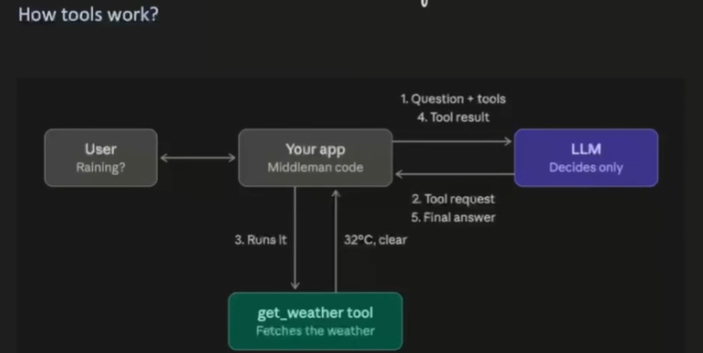
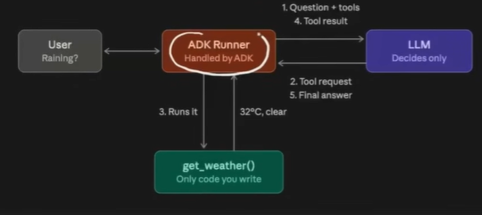
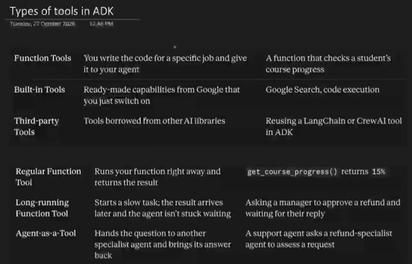
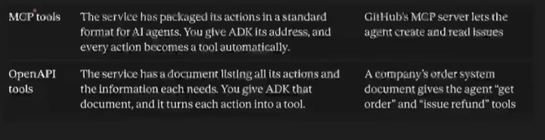

# Tools(in context of an agent!) (https://www.youtube.com/watch?v=CeeDMWuqe7s)
->In an AI agent, tools are the functions or capabilities a language model can call to act beyond generating text. The model can only produce words, so tools are how it reaches out to the world: looking things up, running code, reading files, or taking actions in other systems. 

**Common kinds of tools**
**Information retrieval:** web search, database queries, document lookup (RAG) 

 

**Computation**: a code interpreter, a calculator 

 

**File and system access:** reading and writing files, running shell commands 

 

**External actions:** sending email, creating calendar events, calling APIs, controlling a browser 

