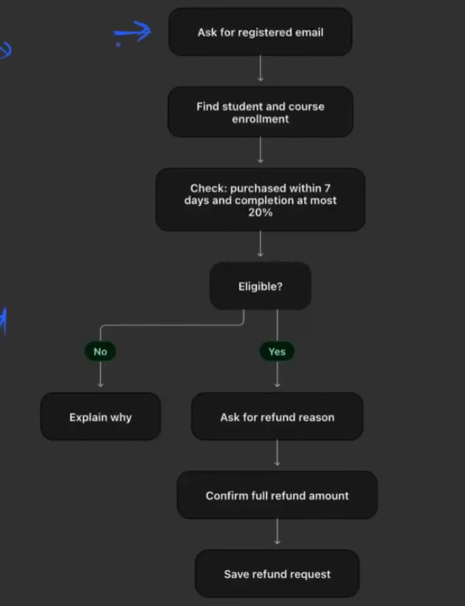
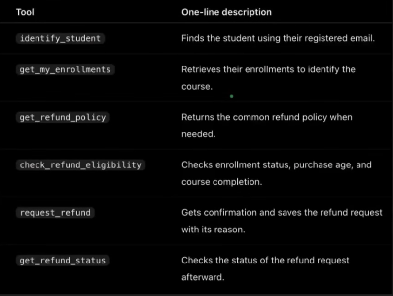
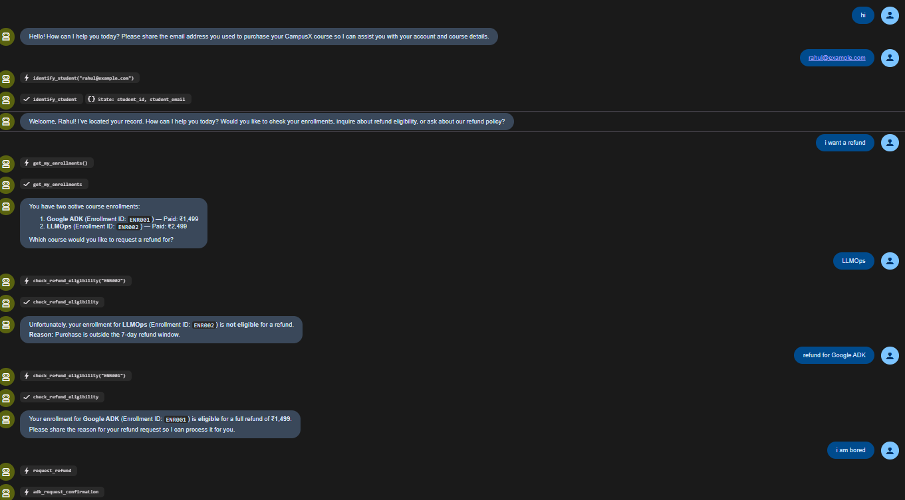

# Project Idea
In entech industry people buy course and sometime they opt-out inbetween , while opting out they sometime ask for refund of the course, and in most of the 
company refund is handeled manually by admin team. He first check the refund policy and based on that handle the refund. Now we want to automate this process.

**A refund Agent** which will automate the refund process of edtech company.
Let say for company_p we are building the refund agent. The company has refund policy that the refund will be initiated if course completion  is less than 20% and 
the refund is initiated within 7 days of the course parchase.

**Workflow**

**process**
1. the student will ask for refund
2. the agent will go to database and check weather the student is enrollend in course or not
3. then check refund condition
4. if the candidate is eligible for refund
5. ask refund reason
6. confirm full refund
7. send refund request to Razorpay api to refund the money to a perticular account

## Database
1. student
2. course
3. enrollment table (which student has enrollend in which course)

## Tools

**Agent**
